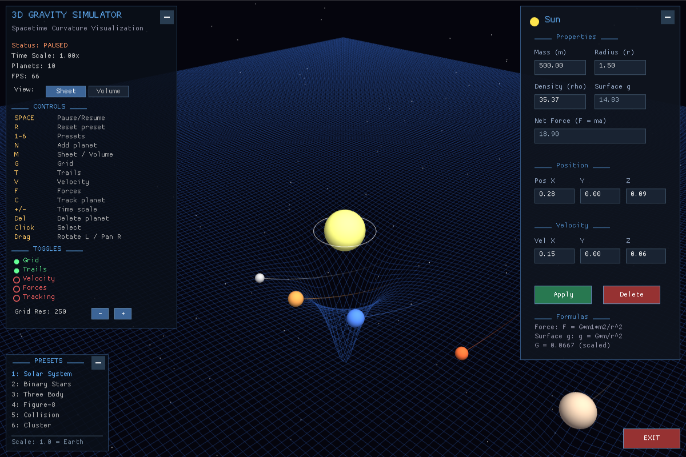

# 3D Gravity Simulator

A planetary N-body simulation that draws gravity as spacetime curvature:
either a sheet bent into a well under every body, or a 3D lattice pulled
toward them.

**Try it in your browser: https://joshchomps.github.io/Gravity-well-sim/**



This repo holds two versions of the same simulator:

- **[`rust/`](rust/)**: the current one. A single Rust codebase that runs as a
  desktop app and in a web browser (WebAssembly). It brings together what
  used to be three separate projects: this Python original, a 3D-grid
  variant (now a second view, press `M`) and a JavaScript web version.
  [rust/VARIANTS.md](rust/VARIANTS.md) lists what came from each and what
  changed.
- **The Python original** at the root (pygame + PyOpenGL). It is kept as the
  reference: the Rust physics gives exactly the same numbers, and tests
  check that.

## Controls

| Key / mouse | Action |
|---|---|
| Left drag / right drag / wheel | Rotate / pan / zoom the camera |
| Click | Select a body and edit it in the right-hand panel |
| `Space` | Pause or resume |
| `1`-`6`, `R` | Load a preset, reload the current one |
| `N`, `Del` | Add a random planet, delete the selected one |
| `M` | Switch between the sheet and 3D-grid views |
| `G` `T` `V` `F` | Grid, trails, velocity arrows, force arrows |
| `C` | Camera follows the selected body |
| `+` / `-` | Time scale (0.25x to 5x) |

## Rust version

You need Rust (https://rustup.rs). Run these from the `rust` folder.

**Desktop:**

```bash
cargo run --release
```

**Browser:** build, then serve the `dist` folder with any static file server
and open http://127.0.0.1:8080.

```powershell
rustup target add wasm32-unknown-unknown   # first time only
.\build-web.ps1
python -m http.server 8080 -d dist
```

On macOS or Linux the script's steps are: run
`cargo build --release --target wasm32-unknown-unknown`, then copy
`web/index.html`, macroquad's `js/mq_js_bundle.js` and
`target/wasm32-unknown-unknown/release/gravity-sim.wasm` into `dist/`. The
live demo above is built the same way by
[a GitHub Actions workflow](.github/workflows/pages.yml) on every push.

**Tests:**

```bash
cargo test
```

These include the Python-parity tests. They step every preset 1,200 times
and compare positions, velocities, merges and both grids against numbers
recorded from the Python; the difference is zero. The recorded numbers are in
`rust/tests/fixtures`, so Python is not needed to run the tests. To record
them again, set up the Python as below, then from `rust`:

```bash
..\.venv\Scripts\python tools\make_fixtures.py
```

## Python version

Set up once (Python 3.12), from the repo root:

```bash
python -m venv .venv
.venv\Scripts\pip install -r requirements.txt
```

Then either double-click **`run.bat`**, or open the folder in VS Code, pick
the `.venv` interpreter (bottom-right corner) and run `main.py`.

Its physics tests run without opening a window: Newton's third law, momentum
and energy conservation, a circular orbit holding its radius, merges
conserving mass, momentum and volume, and every preset running without
blowing up.

```bash
python -m unittest discover -s tests
```
